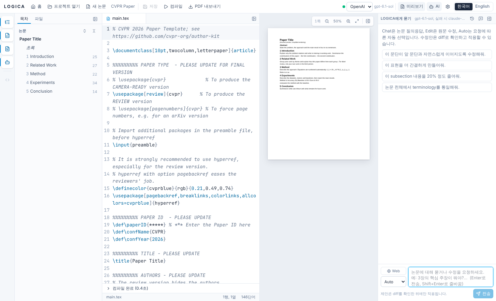
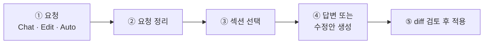

  

<h1 align="center">LOGICA</h1>

  <b>Prism 너무 답답해서 직접 만드는 논문 에이전트</b> 

  
  
  

> **Researcher writes. AI edits on demand.**
> AI는 요청한 순간에만 개입하고, 모든 AI 수정은 diff로 확인하고 승인해야 원고에 반영됩니다.

## 주요 기능

- **논문 쓰기**: 목차 트리, 여러 파일 탭 편집, `\cite`·`\ref` 자동완성, 정의 위치로 이동
- **실시간 미리보기**: TeX 엔진 내장(따로 설치할 필요 없음), 입력을 멈추면 자동 컴파일, PDF 내보내기
- **AI 논문 에이전트**: 논문 전체를 읽고 질문에 답하거나 수정안을 제안, 필요하면 웹에서 근거를 찾아 첨부
- **로컬 우선**: 원고, 대화 기록, 설정은 모두 내 컴퓨터에만 저장. 자체 서버 없음

<b>기능 상세 보기</b>

| 영역 | 기능 |
| --- | --- |
| 메인 화면 | 새 논문 만들기(CVPR 템플릿은 `문서/LOGICA/CVPR Paper N`에 CVPR 공식 author kit 양식, 빈 템플릿은 `문서/LOGICA/My Paper N`에 한 페이지짜리 기본 구조), 폴더 열기, 최근 작업 목록(논문 제목, 위치, 마지막으로 연 시각, PDF 첫 페이지 썸네일), 목록에서 지우기. 작업 화면의 **홈** 버튼으로 돌아옴. 배경에는 숫자와 수식이 파도처럼 떠올랐다 사라지고 클릭한 곳에서 파동이 퍼지는 WebGL2 애니메이션이 흐름(시스템의 동작 줄이기 설정이나 GPU 가속이 없는 환경에서는 정지 화면) |
| 프로젝트 | 폴더 열기, `main.tex` 자동 탐지(또는 직접 지정), `\input` / `\include` 추적, 여러 파일 탭 편집, 외부 수정 감지 |
| Outline | `\part` ~ `\subsubsection` 트리, 번호(부록은 A, B, ...), 접기/펼치기, 현재 커서 section 강조, 클릭 시 원본 위치로 이동, section별 단어 수, 현재 section의 파일:줄 표시 |
| Editor | CodeMirror 6, LaTeX 문법 강조, 줄 번호, 괄호 매칭, undo/redo, 검색/바꾸기, 저장 상태 표시, `\section` `\cite` `\ref` `\eqref` `\label` 등 자동완성 |
| 미리보기와 PDF | TeX 엔진 내장(설치된 TeX가 없으면 자동 사용), 입력을 멈추면 자동 저장 후 컴파일하는 실시간 미리보기(설정에서 끌 수 있음), 논문 페이지만 보이는 미리보기, **PDF 내보내기**로 원하는 위치에 저장, `latexmk` > `pdflatex` > `xelatex` 순 자동 선택(또는 직접 지정/사용자 명령), 타임아웃, 주요 오류만 추출(파일:줄 클릭 이동) |
| AI 채팅 (에이전트) | Chat/Edit/Auto 모드, 공통 요청 정제, 실행별 섹션 선택. Chat은 질의응답, Edit은 수정·참고 원문으로 tool 변경안을 생성하고 diff 검토 후 개별/전체 적용·거절. Auto만 의도를 분류하며, 원문 적용 후 변경 섹션 요약 갱신. 웹 검색을 켜면 Chat은 출처와 함께 답하고, Edit은 수정 전 웹 리서치로 수정안마다 근거 표시 |
| Citation / Reference | `references.bib` 파싱, `\cite{` 입력 시 key/제목/저자/연도 자동완성, `\ref{` 라벨 자동완성, `\ref` `\eqref` `\cite` `\input` 위에서 `F12` 또는 `Cmd/Ctrl+클릭`으로 정의 위치 이동 |
| 상태 복원 | 마지막 프로젝트, 열린 파일, 파일별 커서 위치, outline 접힘 상태, 패널 크기와 표시 여부, 테마, provider와 model 선택 |

## 시작하기

### 1. 설치

[Releases](https://github.com/kimsunggak/Logica/releases/latest)에서 Windows 설치 파일을 받아 실행합니다.

| OS | 받을 파일 |
| --- | --- |
| Windows | `LOGICA_<버전>_x64-setup.exe` |

현재는 Windows만 지원합니다. macOS와 Linux용 설치 파일은 아직 제공하지 않습니다.

> [!WARNING]
> 설치 파일에 코드 서명이 없어 처음 실행할 때 경고가 뜹니다.
> **추가 정보 → 실행**을 누르면 됩니다.

### 2. AI 연결

설정(<kbd>Ctrl</kbd>+<kbd>,</kbd>) → **AI**에서 하나 이상 연결합니다. 연결하지 않아도 편집, 컴파일, PDF 내보내기는 모두 쓸 수 있습니다.

| Provider | 연결 방법 |
| --- | --- |
| OpenAI | **ChatGPT로 로그인**(ChatGPT 요금제 사용) 또는 OpenAI API key |
| Claude | Anthropic API key |

둘 다 연결하면 한쪽 호출이 실패할 때 다른 쪽으로 자동 전환됩니다.

## 사용법

### 논문 쓰기

1. 메인 화면에서 **새 논문**(CVPR 또는 빈 템플릿)을 만들거나 **폴더 열기**로 기존 LaTeX 프로젝트를 엽니다. 새 논문은 `문서/LOGICA` 폴더에 만들어집니다.
2. 왼쪽 **목차**에서 섹션을 누르면 그 위치로 이동합니다. `main.tex`를 찾지 못하면 **파일** 탭에서 ★ 버튼으로 main 파일을 지정합니다.
3. 가운데 편집기에서 씁니다. 입력을 멈추면 자동으로 저장·컴파일되어 오른쪽 미리보기가 바뀝니다. 컴파일 오류는 편집기 아래에 파일:줄로 표시되고, 누르면 그 줄로 이동합니다.
4. 완성본은 **PDF 내보내기**로 저장합니다.

### AI 논문 에이전트

<kbd>Ctrl</kbd>+<kbd>Shift</kbd>+<kbd>L</kbd>로 채팅 패널을 열고, 입력창 왼쪽에서 모드를 고른 뒤 요청합니다.

| 모드 | 이럴 때 | 결과 |
| --- | --- | --- |
| **Chat** | 논문 내용을 묻고 싶을 때 | 답변. 원고는 바뀌지 않음 |
| **Edit** | 원고를 고치고 싶을 때 | 수정안을 diff로 보여 줌 → **적용** / **거절** / **모두 적용** |
| **Auto** | 어느 쪽인지 고르기 애매할 때 | 요청을 보고 Chat 또는 Edit을 고름. 판단이 어려우면 되물음 |

- **웹 검색**: 입력창 옆 **Web** 버튼을 켜면, Chat은 논문만으로 부족할 때 웹을 검색해 출처와 함께 답하고, Edit은 고치기 전에 필요한 정보를 웹에서 찾아 수정안마다 근거를 붙입니다.
- **대화 기록**: 대화는 프로젝트별로 저장됩니다. 패널 위쪽 버튼으로 이전 대화를 불러오거나 새 대화를 시작합니다.

> [!TIP]
> 에이전트는 커서 위치나 열린 탭으로 대상을 추측하지 않습니다. "3.2절 두 번째 문단을 간결하게"처럼 섹션이나 문장을 지정하면 정확해집니다.

<b>단축키 전체 보기</b>

| 단축키 | 동작 |
| --- | --- |
| <kbd>Ctrl</kbd>+<kbd>O</kbd> | 프로젝트 열기 |
| <kbd>Ctrl</kbd>+<kbd>S</kbd> | 현재 파일 저장 |
| <kbd>Ctrl</kbd>+<kbd>Shift</kbd>+<kbd>S</kbd> | 모두 저장 |
| <kbd>Ctrl</kbd>+<kbd>Enter</kbd> | 컴파일 |
| <kbd>Ctrl</kbd>+<kbd>Shift</kbd>+<kbd>L</kbd> | AI 채팅 패널 열기/닫기 |
| <kbd>F12</kbd>, <kbd>Ctrl</kbd>+클릭 | `\ref` `\eqref` `\cite` `\input` 대상으로 이동 |
| <kbd>Ctrl</kbd>+<kbd>F</kbd> | 검색 / 바꾸기 |
| <kbd>Ctrl</kbd>+<kbd>,</kbd> | 설정 |

## 작동 방식

에이전트는 요청 하나를 다섯 단계로 처리합니다.

| 단계 | 하는 일 |
| --- | --- |
| ① 요청 | 고른 모드로 요청을 보냅니다. Auto는 ② 다음에 요청을 보고 Chat 또는 Edit을 고릅니다. |
| ② 요청 정리 | 대화 기록을 보고 "그거", "아까 그 문단" 같은 지시 대상을 복원해 요청을 명확하게 다시 씁니다. |
| ③ 섹션 선택 | 논문 요약 지도를 보고 원문으로 읽을 섹션을 고릅니다. Edit은 고칠 섹션과 참고할 섹션을 나눠 고릅니다. |
| ④ 실행 | 고른 섹션은 원문으로, 나머지는 요약으로 읽고 답하거나 수정안을 만듭니다. 웹 검색을 켜 두면 이 단계에서 웹을 찾습니다. |
| ⑤ 검토·적용 | 수정안이 현재 원문과 정확히 일치하는지 확인해 diff로 보여 주고, 승인한 것만 원고에 반영합니다. |

이 흐름을 받쳐 주는 장치는 세 가지입니다.

- **논문 요약 지도**: 첫 질문 때 논문을 섹션별로 요약해 두고, 이후에는 고친 섹션만 다시 요약합니다. 그래서 긴 논문도 필요한 섹션만 원문으로 보내 처리합니다.
- **대화 메모리**: 대화가 길어지면 오래된 턴을 주제·목표·기록으로 접어 두고, 최근 대화와 함께 읽습니다.
- **LaTeX 검사**: AI 결과에서 괄호·환경 짝, `\label`, citation key가 깨지거나 바뀌면 diff 아래에 오류나 경고로 표시합니다.

단계별 상세, 모델 구성, 요약 형식은 [docs/architecture.md](docs/architecture.md)에 있습니다.

## 데이터와 개인정보

- 원고와 컴파일 결과는 논문 폴더에, 대화 기록·논문 요약·설정은 앱 데이터 폴더에 저장됩니다. LOGICA는 자체 서버가 없습니다.
- AI 기능을 쓸 때만 요청과 필요한 원고 내용(고른 섹션의 원문 또는 요약)이 연결한 provider(OpenAI, Anthropic)로 전송됩니다. 웹 검색을 켜면 검색은 provider 쪽에서 실행됩니다.
- API key와 ChatGPT 로그인 토큰은 Windows 자격 증명 관리자에만 저장되고, 파일로는 저장되지 않습니다.

<b>저장 위치 보기</b>

| 데이터 | 위치 (Windows) |
| --- | --- |
| 논문 원고와 PDF | 논문 폴더 (새 논문은 `문서\LOGICA\My Paper N`, `문서\LOGICA\CVPR Paper N`) |
| 대화 기록 | `%LOCALAPPDATA%\app.logica.desktop\chats\` |
| 논문 요약 | `%LOCALAPPDATA%\app.logica.desktop\papers\` |
| 설정, 최근 작업 | `%APPDATA%\app.logica.desktop\state.json` |

- 앱을 삭제해도 이 폴더들은 남습니다. 완전히 지우려면 직접 삭제하세요.

인증 방식과 보안 설계는 [docs/security.md](docs/security.md)에 있습니다.

## 알려진 제한

- PDF와 소스 사이 양방향 이동(SyncTeX)은 아직 없습니다.
- 코드 접기와 목차 드래그로 순서 바꾸기는 지원하지 않습니다.
- 목차는 `\input`, `\include`만 따라갑니다. `\subfile`, `\import`는 따라가지 않습니다.
- 단어 수는 명령어, 수식, citation key를 뺀 근사치입니다.

## 개발자 문서

| 문서 | 내용 |
| --- | --- |
| [docs/development.md](docs/development.md) | 소스 빌드, 개발 실행(LOGICA Dev), 테스트, 런타임 디버거 |
| [docs/architecture.md](docs/architecture.md) | 에이전트 단계별 동작, 웹 검색, 세션 요약, 논문 요약, 코드 구조 |
| [docs/security.md](docs/security.md) | AI 인증 방식, 외부로 전송되는 데이터, 보안 설계 |

## 라이선스

[MIT](LICENSE). 내장 TeX 엔진 Tectonic과 CVPR author kit의 라이선스 고지는 [`src-tauri/licenses/`](src-tauri/licenses/)에 있습니다.
