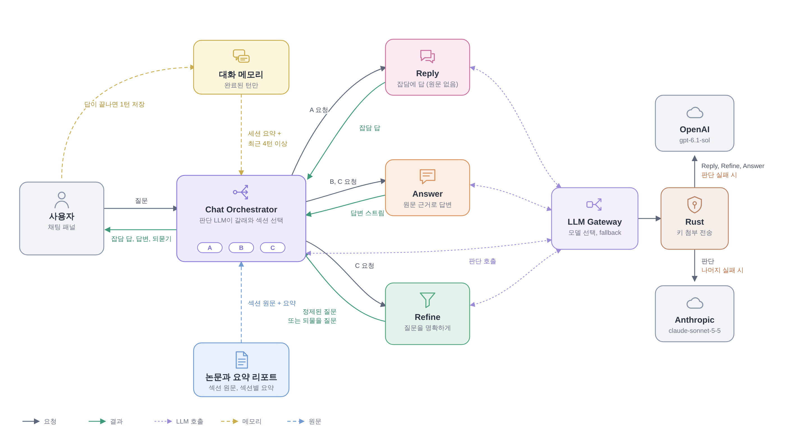
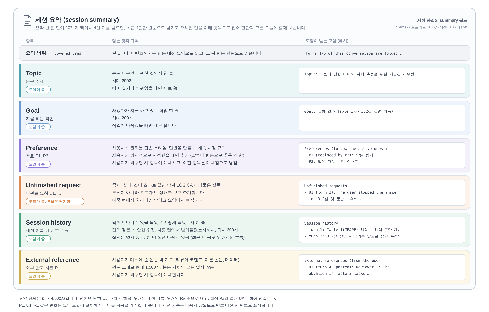

# LOGICA

Logical Guidance for Intelligent Critical Academic-writing

LOGICA는 개인 연구용 로컬 LaTeX 논문 작성 도구입니다. 논문 전체 구조를 한눈에 보면서 LaTeX 원고를 직접 쓰고, 필요한 부분만 AI로 빠르게 고칩니다.

> **Researcher writes. AI edits on demand.**
> AI는 사용자가 요청한 순간에만 개입하고, 모든 AI 수정은 diff로 확인한 뒤에만 원고에 반영됩니다.

```
┌──────────────────┬──────────────────────────┬──────────────────┬───────────┐
│ Outline / Files  │ LaTeX Editor             │ PDF Preview      │ AI (opt.) │
└──────────────────┴──────────────────────────┴──────────────────┴───────────┘
```

## 주요 기능

| 영역 | 기능 |
| --- | --- |
| 메인 화면 | 새 논문 만들기(CVPR 템플릿은 `문서/LOGICA/CVPR Paper N`에 CVPR 공식 author kit 양식, 빈 템플릿은 `문서/LOGICA/My Paper N`에 한 페이지짜리 기본 구조), 폴더 열기, 최근 작업 목록(논문 제목, 위치, 마지막으로 연 시각, PDF 첫 페이지 썸네일), 목록에서 지우기. 작업 화면의 **홈** 버튼으로 돌아옴. 배경에는 숫자와 수식이 파도처럼 떠올랐다 사라지고 클릭한 곳에서 파동이 퍼지는 WebGL2 애니메이션이 흐름(시스템의 동작 줄이기 설정이나 GPU 가속이 없는 환경에서는 정지 화면) |
| 프로젝트 | 폴더 열기, `main.tex` 자동 탐지(또는 직접 지정), `\input` / `\include` 추적, 여러 파일 탭 편집, 외부 수정 감지 |
| Outline | `\part` ~ `\subsubsection` 트리, 번호(부록은 A, B, ...), 접기/펼치기, 현재 커서 section 강조, 클릭 시 원본 위치로 이동, section별 단어 수, 현재 section의 파일:줄 표시 |
| Editor | CodeMirror 6, LaTeX 문법 강조, 줄 번호, 괄호 매칭, undo/redo, 검색/바꾸기, 저장 상태 표시, `\section` `\cite` `\ref` `\eqref` `\label` 등 자동완성 |
| 미리보기와 PDF | TeX 엔진 내장(설치된 TeX가 없으면 자동 사용), 입력을 멈추면 자동 저장 후 컴파일하는 실시간 미리보기(설정에서 끌 수 있음), 논문 페이지만 보이는 미리보기, **PDF 내보내기**로 원하는 위치에 저장, `latexmk` > `pdflatex` > `xelatex` 순 자동 선택(또는 직접 지정/사용자 명령), 타임아웃, 주요 오류만 추출(파일:줄 클릭 이동) |
| AI 인라인 편집 | 텍스트 선택 후 `Cmd/Ctrl+K`, 기본 명령(Improve writing, Make concise, Make academic, Improve clarity, Fix grammar, Rewrite, 직접 입력), streaming 표시, Stop, diff 확인 후 Accept / Reject / Regenerate(다른 provider로 재생성 가능) |
| AI 채팅 (에이전트) | Chat Orchestrator가 질문마다 처리 갈래를 고름: 잡담은 Reply Module이 답하고, 명확한 질문은 바로 답변하고, 모호한 질문은 논문 전체를 보고 명확한 질문으로 정제한 뒤 답변(정제해도 모호하면 되물음). 수정 요청에는 여러 곳, 여러 파일의 수정안을 제안하고 수정마다 diff와 LaTeX 검사 결과를 보여 주며 하나씩 또는 모두 적용/거절 |
| Citation / Reference | `references.bib` 파싱, `\cite{` 입력 시 key/제목/저자/연도 자동완성, `\ref{` 라벨 자동완성, `\ref` `\eqref` `\cite` `\input` 위에서 `F12` 또는 `Cmd/Ctrl+클릭`으로 정의 위치 이동 |
| 상태 복원 | 마지막 프로젝트, 열린 파일, 파일별 커서 위치, outline 접힘 상태, 패널 크기와 표시 여부, 테마, provider와 model 선택 |

## 설치와 실행

### 준비물

- Node.js 20 이상
- Rust stable (1.80 이상)
- Tauri 2 시스템 의존성: <https://v2.tauri.app/start/prerequisites/>
  - Linux(Ubuntu/Debian): `libwebkit2gtk-4.1-dev build-essential libssl-dev libayatana-appindicator3-dev librsvg2-dev`
- TeX 배포판은 필요 없습니다. LOGICA에는 TeX 엔진 [Tectonic](https://tectonic-typesetting.github.io/)이 내장되어 있습니다. TeX Live, MacTeX, MiKTeX가 설치되어 있으면 그쪽을 먼저 씁니다(패키지 호환성이 가장 좋음).
  - `npm run tauri dev` / `npm run tauri build`가 시작될 때 `scripts/fetch-tectonic.mjs`가 해당 플랫폼의 공식 Tectonic 릴리스를 내려받아 고정된 SHA-256과 대조한 뒤 `src-tauri/binaries/`에 둡니다. `cargo`를 직접 실행할 때는 먼저 `npm run tectonic`을 실행하세요.
  - 내장 엔진은 처음 컴파일할 때 필요한 LaTeX 패키지를 인터넷에서 내려받고, 이후에는 캐시를 씁니다.
- Linux에서 API key 저장: Secret Service 구현(GNOME Keyring 또는 KWallet)이 실행 중이어야 합니다.

### 실행

```bash
npm install
npm run tauri dev        # 개발 모드 데스크톱 앱
npm run tauri build      # 배포용 빌드 (src-tauri/target/release/bundle)
```

`examples/sample-paper/`에 바로 열어볼 수 있는 예제 논문이 있습니다.

### 브라우저 미리보기 모드 (개발용)

`npm run dev` 후 브라우저에서 `http://localhost:1420`을 열면 메모리 내 가짜 backend로 UI 전체 흐름을 확인할 수 있습니다. 파일, 컴파일, AI 응답이 모두 시뮬레이션되며(AI 응답도 실제 OpenAI/Claude streaming 형식으로 흉내 내므로 provider adapter 코드가 그대로 실행됩니다) 이 코드는 배포 빌드에 포함되지 않습니다.

## 사용 방법

1. 메인 화면에서 **새 논문**을 누르고 **CVPR 템플릿**이나 **빈 템플릿**을 고르면 그 양식의 논문이 열리고 미리보기가 바로 만들어집니다. 기존 논문은 **폴더 열기**나 최근 작업 카드로 엽니다. `main.tex`가 없으면 Files 탭에서 별(★) 버튼으로 main 파일을 지정합니다.
2. 왼쪽 Outline에서 section을 클릭하면 해당 파일과 줄로 이동합니다.
3. 중앙 편집기에서 직접 수정하고 `Cmd/Ctrl+S`로 저장합니다.
4. 입력을 멈추면 자동으로 저장하고 컴파일해 미리보기가 갱신됩니다. **Compile**(`Cmd/Ctrl+Enter`)로 직접 컴파일할 수도 있습니다. 오류는 편집기 아래에 파일:줄과 함께 표시되며 클릭하면 이동합니다. 완성본은 **PDF 내보내기**로 저장합니다.
5. Settings(`Cmd/Ctrl+,`) > AI에서 OpenAI 또는 Claude API key를 연결하고 model을 고릅니다.
6. 문장이나 문단을 선택하고 `Cmd/Ctrl+K`를 눌러 지시를 입력합니다. 결과가 streaming으로 표시된 뒤 diff가 나타나며, **Accept**를 눌러야만 원고가 바뀝니다.

### 단축키

| 단축키 | 동작 |
| --- | --- |
| `Cmd/Ctrl+O` | 프로젝트 열기 |
| `Cmd/Ctrl+S` | 현재 파일 저장 |
| `Cmd/Ctrl+Shift+S` | 모두 저장 |
| `Cmd/Ctrl+Enter` | 컴파일 (AI diff 검토 중에는 Accept) |
| `Cmd/Ctrl+K` | AI 인라인 편집 (선택이 없으면 커서가 있는 문단을 선택) |
| `Esc` | AI 인라인 편집 닫기 / streaming 중이면 Stop |
| `Cmd/Ctrl+Shift+L` | AI 채팅 패널 열기/닫기 |
| `F12`, `Cmd/Ctrl+클릭` | `\ref` `\eqref` `\cite` `\input` 대상으로 이동 |
| `Cmd/Ctrl+F` | 검색 / 바꾸기 |
| `Cmd/Ctrl+,` | 설정 |

## AI provider와 인증

LOGICA는 특정 provider에 묶이지 않도록 공통 `AIProvider` 인터페이스 뒤에 OpenAI와 Claude adapter를 둡니다.

| Provider | 인증 방식 | API |
| --- | --- | --- |
| OpenAI | **Sign in with ChatGPT** (기본, ChatGPT 요금제 사용) 또는 API key (OpenAI Platform) | Responses API (`POST /v1/responses`, streaming), 모델 목록 `GET /v1/models` |
| Claude / Anthropic | API key (Claude Console) | Messages API (`POST /v1/messages`, streaming), 모델 목록 `GET /v1/models` |

**인증 방식을 고른 이유**

- **OpenAI**: 기본은 OpenAI의 공식 "Sign in with ChatGPT"(오픈소스 로컬 앱용)입니다. API 사용 요금 대신 사용자의 ChatGPT 요금제(대상 요금제)를 씁니다. Settings에서 OpenAI Platform API key 방식으로 바꿀 수도 있습니다. 두 방식 모두 같은 Responses API를 쓰고, 붙이는 credential만 다릅니다.
- **Claude**: Anthropic은 Claude.ai(Free/Pro/Max) 로그인 OAuth를 서드파티 앱에 제공하지 않으며 서드파티 제품은 API key를 쓰도록 안내합니다. 따라서 Anthropic API key만 지원합니다.
- ChatGPT나 Claude.ai의 브라우저 세션, 쿠키를 읽거나 비공식 API를 쓰는 기능은 없습니다.

### Sign in with ChatGPT 작동 방식

구현: `src-tauri/src/chatgpt.rs` (OAuth 2.0 Authorization Code + PKCE S256, loopback redirect)

1. `https://auth.openai.com/.well-known/openid-configuration`에서 endpoint를 받고, 모두 `auth.openai.com`에 속하는지 확인합니다.
2. `state`, `nonce`, PKCE `code_verifier`를 무작위로 만들고 `127.0.0.1`의 빈 포트에 callback(`/auth/callback`)을 엽니다.
3. 기본 브라우저로 로그인 페이지를 엽니다. 첫 로그인은 `client_id=dynamic_agent_client`와 `agent_name_hint=LOGICA`로 요청하고, scope는 `openid profile email offline_access resource.invoke chatgpt.tokens.use.direct`, resource는 `https://api.openai.com/v1`입니다.
4. 사용자가 chatgpt.com에서 로그인하고 LOGICA를 승인하면 callback으로 인증 코드와 **이 설치본에 발급된 실제 `client_id`**가 돌아옵니다. 별도의 사전 앱 등록은 없으며, 발급된 ID는 저장해 다음 로그인에 다시 씁니다.
5. 코드를 `code_verifier`와 함께 token endpoint에서 access token, refresh token, ID token으로 교환하고, ID token의 발급자, 대상, 만료, `nonce`를 검사합니다.
6. AI 요청은 access token을 `Authorization: Bearer`로 붙여 보냅니다. 만료 1분 전이면 refresh token으로 갱신하며(회전된 token은 바로 저장), 갱신이 거부되면 다시 로그인하도록 안내합니다.
7. Sign out은 OpenAI revocation endpoint로 세션을 폐기하고 OS store의 token을 삭제합니다.

사용량 한도는 ChatGPT 설정(<https://chatgpt.com/settings/usage>)에서 앱별로 관리합니다.
- **Claude**: Anthropic은 Claude.ai(Free/Pro/Max) 로그인 OAuth를 서드파티 앱에 제공하지 않으며 서드파티 제품은 API key를 쓰도록 안내합니다. 따라서 Anthropic API key만 지원합니다.
- ChatGPT나 Claude.ai의 브라우저 세션, 쿠키를 읽거나 비공식 API를 쓰는 기능은 없습니다.

### 모델 설정

모델 ID는 `src/ai/models/modelConfig.ts` 한 곳에만 기본값으로 둡니다. provider를 연결하면 Settings에서 **Refresh list**로 계정에서 실제로 쓸 수 있는 모델 목록을 provider API에서 가져오고, 목록에 없는 모델 ID도 직접 추가할 수 있습니다. 선택한 모델은 provider별로 저장됩니다.

## 데이터 저장 위치

모든 데이터는 이 컴퓨터에만 저장됩니다. LOGICA는 자체 서버가 없습니다.

| 데이터 | 위치 (Windows 기준) |
| --- | --- |
| 논문 원고와 컴파일 결과 | 논문 폴더 (기본: `문서\LOGICA\My Paper N`) |
| AI 채팅 기록 | `%LOCALAPPDATA%\app.logica.desktop\chats\<프로젝트 ID>\<세션 ID>.json` (프로젝트 ID는 폴더 경로의 SHA-256 해시, 각 폴더의 `project.json`에 원래 경로 기록) |
| 논문 요약 (섹션별 요약, YAML) | `%LOCALAPPDATA%\app.logica.desktop\papers\<프로젝트 ID>\paper-summary.yaml` (프로젝트 ID는 채팅 기록과 같음) |
| 설정, 최근 작업, 창 배치 | `%APPDATA%\app.logica.desktop\state.json` |
| API key, ChatGPT 로그인 토큰 | Windows 자격 증명 관리자 (macOS 키체인, Linux Secret Service) |

채팅 세션 파일 형식은 `{ version, createdAt, updatedAt, messages, summary }`이며, `summary`의 구조는 아래 [세션 요약 구조](#세션-요약-구조)에 있습니다. 채팅창의 기록 버튼에서 이전 대화를 불러오거나 삭제하고, 새 대화 버튼으로 새 세션을 시작합니다. 논문 요약(섹션별 요약)은 세션과 따로 프로젝트마다 하나이며, 형식은 아래 [논문 요약 문서](#논문-요약-문서)에 있습니다. 질문할 때 보내는 내용(원고 또는 섹션 요약, 질문)과 섹션 요약을 만들 때 보내는 섹션 원문은 OpenAI로 전송되고, OpenAI 호출이 실패하면 Anthropic API key가 연결된 경우 같은 내용이 Anthropic으로 전송됩니다.

## 보안 설계

1. **API key와 ChatGPT token은 OS credential store에만 저장**합니다: macOS Keychain, Windows Credential Manager, Linux Secret Service (`keyring` crate). secure store를 쓸 수 없으면 저장하지 않고 오류를 보여주며, plaintext 파일로 대체 저장하지 않습니다. Windows Credential Manager의 항목당 크기 제한(2.5KB) 때문에 OAuth token 묶음은 여러 항목으로 나눠 저장합니다.
2. **key는 webview로 돌아오지 않습니다.** 프런트엔드는 key를 한 번 backend로 넘겨 저장할 뿐이고, 이후에는 "저장됨"과 끝 4자리 힌트만 받습니다. AI 요청은 Rust backend가 OS store에서 key를 읽어 헤더에 붙여 보냅니다.
3. **요청 대상 allowlist**: backend는 `api.openai.com`과 `api.anthropic.com`의 정해진 endpoint(`/v1/responses`, `/v1/messages`, `/v1/models`)로만 요청을 보냅니다.
4. **오류 메시지 redaction**: provider 오류 본문과 네트워크 오류에서 key와 `sk-...` 형태 토큰을 지운 뒤 화면에 표시합니다. key를 로그로 출력하지 않습니다.
5. **Disconnect / Sign out은 OS store의 항목을 실제로 삭제**하고, ChatGPT 연결은 OpenAI에서도 폐기합니다.
6. 설정과 작업 상태(`state.json`, 앱 설정 폴더)에는 secret이 들어가지 않으며, 저장 직전에도 `apiKey` `token` 같은 이름의 필드를 한 번 더 걸러냅니다.
7. 파일 접근은 연 프로젝트 폴더 안으로 제한됩니다(절대 경로, `..`, 심볼릭 링크 탈출 차단).
8. 저장소에는 `.env`나 credential이 없고 `.gitignore`가 이를 막습니다.

## AI context 구성

인라인 편집은 선택 텍스트만 보내지 않고, 같은 문서 모델(`PaperDocument`)에서 필요한 부분만 골라 공통 semantic context를 만듭니다. 채팅은 논문에 대한 첫 질문에서 먼저 논문을 섹션별로 요약해 두고, 질문에 필요한 섹션만 원문으로, 나머지 섹션은 그 요약으로 보냅니다.



AI 채팅 에이전트 구조 (원본: [`docs/images/chat-agent-architecture.svg`](docs/images/chat-agent-architecture.svg)). 사용자 질문은 Chat Orchestrator로 들어가고, 판단 LLM이 툴 하나로 갈래(A 잡담, B 바로 답변, C 정제 후 답변)와 원문으로 읽을 섹션을 고릅니다. 각 모듈의 결과는 오케스트레이터를 거쳐 화면에 표시되고, 답이 끝난 질문은 대화 메모리에 1턴으로 저장됩니다.

- 인라인 편집: 논문 제목, abstract, outline, 현재 section 경로(예: `3 Method › 3.2 Uncertainty Estimation`), 앞 문단, 선택 텍스트, 다음 문단
- 채팅: 한 질문에 모델을 최대 3번 부릅니다(답변이 섹션 원문을 더 요청하면 4번). 논문에 대한 첫 질문에서는 판단보다 먼저 논문 요약을 부르고(약 40,000자마다 1번), 그 뒤에는 고친 섹션이 있을 때만 턴이 끝난 뒤 백그라운드로 다시 부릅니다. 세션 요약은 백그라운드로 2턴마다 1번 부릅니다. 판단은 `claude-sonnet-5-5`(reasoning high, 실패하면 `gpt-6.1-sol`), 나머지는 `gpt-6.1-sol`(실패하면 `claude-sonnet-5-5`)입니다(`src/ai/models/modelConfig.ts`의 `CHAT_MODELS`).
  1. 판단(Chat Orchestrator): 세션 요약, 최근 4턴 원문, 논문 지도(섹션별 키, 제목, 단어 수, label, 요약), 질문 순서로 보냅니다. 원고 본문은 보내지 않습니다. 모델은 `reply_directly`, `answer_question`, `refine_question` 중 하나를 반드시 부르고, 인자 `reason`에 그 갈래를 고른 근거(다른 두 갈래가 아닌 이유)를 적습니다. `answer_question`과 `refine_question`은 인자 `sections`에 원문으로 읽을 섹션 키를 함께 적습니다(요약으로 충분하면 빈 목록, 논문 전체가 필요하면 `["all"]`). 판단 모델은 사용자에게 보이는 글을 쓰지 않습니다. 툴 호출은 강제하되(OpenAI `required`, Claude `any`), Claude는 thinking을 켜면 강제 호출을 받지 않으므로 `auto`로 보내고 프롬프트로 요구합니다. 그래도 툴 없이 글만 오면 잡담으로 처리합니다.
     - 잡담(`reply_directly`)이면 Reply Module(reasoning low)이 세션 요약, 요약에 아직 안 들어간 턴, 질문만 보고 답합니다. 원고는 보내지 않으므로 잡담은 모델을 2번 부릅니다.
  2. 정제(Refine Module, reasoning medium, 판단이 `refine_question`일 때만): 논문(초록과 판단이 고른 섹션은 원문, 나머지는 섹션 요약. 요약을 만들지 못했으면 원고 전체, 최대 150,000자), 세션 요약, 요약에 아직 안 들어간 턴, 질문. 명확한 질문 하나로 다시 쓰거나 되물을 질문을 JSON으로 돌려줍니다. 섹션 단위로 받았을 때는 질문을 다듬은 뒤 원문으로 읽을 섹션을 `sections`로 다시 고르며, 이 선택이 판단의 선택을 대신합니다.
  3. 답변(Answer Module, reasoning medium): 논문(정해진 섹션은 원문, 나머지는 요약), 세션 요약, 요약에 아직 안 들어간 턴, 원래 질문, 정제된 질문(있을 때). 요약만 받은 섹션의 원문이 필요하면 `[[need_sections: 4.3]]`처럼 답하고, 그 섹션을 원문으로 받아 한 번 더 답합니다(한 번만, 이 요청은 화면에 보이지 않습니다). 요약에 답하지 못한 요청이 있으면 관련 있을 때 함께 처리하고, 관련 없으면 끝에 이어서 할지 한 줄로 묻습니다.
  - 편집기의 상태(열린 파일, 선택 텍스트, 커서 문단과 section)는 보내지 않습니다. 열린 탭과 커서는 마지막으로 작업한 자리에 남아 있어 질문과 관계없는 경우가 많기 때문입니다. 특정 부분을 물으려면 질문에 section 이름이나 문장을 적습니다.
  - 대화 상태는 네 층으로 보냅니다(`src/chat/paper/`, `src/chat/session/`).
    - L0: 규칙과 툴, 그리고 논문. 판단은 대화 다음에 논문 지도를 받고, 정제와 답변은 섹션 원문과 요약(또는 원고 전체)을 맨 앞에 받습니다. 정제와 답변은 앞부분이 같아야 prompt cache를 쓰므로 가장 덜 바뀌는 논문을 맨 앞에 둡니다.
    - L1 세션 요약: 오래된 턴을 접은 대화 요약입니다(목표, 선호 P#, 답하지 못한 요청 U#, 다룬 내용 T#, 사용자가 준 논문 밖 자료 R#). 요약에 안 들어간 턴이 4개가 되면 마지막 2턴을 남기고 나머지를 접습니다(4턴 끝, 6턴 끝, 8턴 끝처럼 2턴마다). 요약 모듈(`gpt-6.1-sol` low)은 요약을 새로 쓰지 않고 `update_summary` 툴로 바뀐 항목만 돌려주며, 코드가 검사해 적용합니다. 항목 구조는 아래 [세션 요약 구조](#세션-요약-구조)에 있습니다.
    - L2 최근 턴 원문: 공통 선택 함수가 판단은 최근 4턴(메시지당 10,000자), 나머지 모듈은 최근 2턴(메시지당 4,000자)을 선택합니다. 요약이 지연되거나 실패하면 모든 미요약 턴까지 범위를 넓혀 대화 누락을 막습니다. 메시지 길이 상한을 넘으면 앞 70%와 뒤 30%를 남기고 가운데를 생략 표시합니다.
    - L3: 지금 질문과 모듈의 작업 지시. 지금 질문은 자르지 않습니다.
  - 1턴은 질문 하나와 그 결과입니다. 중지되거나 실패하거나 길이 초과로 잘린 답도 턴으로 남기고 `[answer stopped by the user]` 같은 표시를 붙여, 다음 질문에서 모델이 답하지 못한 요청을 알 수 있게 합니다(오류 문구 자체는 보내지 않습니다). 지금 보내는 질문은 아직 턴이 아니므로, 첫 질문에서 디버거의 `session_turns`는 0입니다. Orchestrator 입력에는 `session_turns`, `summary_covered_turns`, 논문 지도의 요약 수(`paper_map`)를, 출력에는 고른 `sections`를, 각 LLM 호출에는 실제 읽는 원문 번호 `turn_numbers`와 잘린 메시지를 표시합니다. 정제와 답변의 `paperView` 단계에는 원문으로 보낸 섹션, 요약으로 보낸 섹션 수, 요약이 없어 원문으로 보낸 섹션이 나옵니다. 세션 요약과 섹션 요약 실행은 그 턴의 그래프에 Summary Module(오른쪽 아래)과 Section Summary Module로 나타납니다. Section Summary Module은 첫 질문에서는 판단보다 먼저 실행되어 User Input 옆에, 그 뒤에는 턴이 끝난 뒤 실행되어 왼쪽 아래에 나오고, 실행할 조건이 아니면 비활성으로 표시됩니다.
  - 정제와 답변 요청은 같은 system prompt, 원고, 세션 요약, 대화로 시작하고 각자의 지시와 질문을 마지막 메시지에 둡니다. 앞부분이 같아야 provider의 prompt cache가 두 번째 호출에서 원고를 다시 계산하지 않기 때문입니다. 캐시된 토큰 수는 런타임 디버거에서 확인합니다.

문단은 빈 줄로 나누며, `\section`, `\begin`/`\end`, `\label`, 주석 줄 같은 구조 줄과 `\title`, `\author`, `\date` 같은 앞부분 명령(여러 줄에 걸치면 닫는 중괄호까지), 그리고 `\begin{document}` 앞의 preamble 전체는 문단에 넣지 않습니다. 그래서 "이 문단 고쳐줘"가 section 제목이나 논문 제목을 바꾸지 않습니다.

### 세션 요약 구조



세션 요약은 대화가 길어질 때 오래된 턴을 원문 대신 줄여 보내는 대화 메모리입니다(원본 그림: [`docs/images/session-summary.svg`](docs/images/session-summary.svg)). 세션 파일(`chats/<프로젝트 ID>/<세션 ID>.json`)의 `summary` 필드에 저장되고, 판단과 모든 모듈이 최근 턴 원문과 함께 읽습니다. 구조는 다음과 같습니다.

- **요약 범위** (`coveredTurns`): 턴 1부터 이 번호까지는 원문 대신 요약으로 읽고, 그 뒤 턴은 원문으로 읽습니다.
- **Goal** (목표): 논문의 주제와 지금 하고자 하는 작업입니다. 한두 문장(최대 300자)이고, 작업이 바뀌었을 때만 새로 씁니다.
- **Preference** (선호, P#): 사용자가 원하는 답변 스타일이나 답변을 만들 때 계속 지켜야 하는 규칙입니다. 사용자가 명시적으로 지정했을 때만 추가하고, 말투나 반응으로 추측하지 않습니다. 사용자가 바꾸면 새 항목이 대체하고, 이전 항목은 대체됨으로 표시해 남깁니다.
- **Unresolved** (답하지 못한 요청, U#): 중지, 실패, 길이 초과로 끝난 답과 LOGICA가 되물은 질문입니다. 모델이 아니라 코드가 턴 상태를 보고 추가하고, 나중 턴에서 처리되면 닫혀서 요약에서 빠집니다.
- **Topic** (다룬 내용, T#): 답한 턴마다 무엇을 다뤘는지(섹션, 그림, 표, 질문) 한 줄로 남깁니다. 잡담은 넣지 않고, 항목마다 최대 200자입니다.
- **Reference** (사용자 자료, R#): 사용자가 대화에 준 논문 밖 자료(리뷰어 코멘트, 다른 논문의 글, 데이터)를 원문 그대로 최대 1,500자까지 담습니다. 논문 자체의 글은 넣지 않습니다.

요약 전체는 최대 4,000자이며, 넘치면 닫힌 U#, 대체된 항목, 오래된 T#, 오래된 R# 순으로 빼고 활성 P#와 열린 U#는 항상 남깁니다.

### 논문 요약 문서

논문에 대한 첫 질문에서 Section Summary Module(`src/chat/paper/`)이 판단보다 먼저 논문을 섹션별로 요약해 YAML 문서로 저장합니다. 판단은 이 요약을 논문 지도로 받아 원문으로 읽을 섹션을 고르고, 정제와 답변은 고르지 않은 섹션을 이 요약으로 읽습니다.

- 순서: 논문의 읽는 순서대로 abstract(제목 블록과 초록), introduction, 이후 섹션이 이어지고, 하위 절은 `subsections` 아래에 들어갑니다.
- 요약: 섹션마다 논문의 언어로 3~4줄(한 줄에 한 문장)입니다. 자기 본문이 없는 섹션(제목과 label만 있고 내용은 하위 절에 있는 섹션 포함)은 "아직 내용 없음", 본문이 아주 짧은 섹션은 본문을 그대로 씁니다.
- 갱신: 처음 한 번 만든 뒤에는, 본문을 고친 섹션만 그 턴에는 원문으로 읽고 턴이 끝난 뒤 다시 요약합니다. `hash`(섹션 본문의 해시)로 바뀐 섹션을 찾습니다.
- 요약을 만들지 못하면 그 질문은 원고 전체로 답하고, 턴이 끝난 뒤 다시 시도합니다.

```yaml
version: 1
title: Adaptive Spatiotemporal Routing for Occlusion-Robust Video Pose Estimation
updated: 2026-10-21T07:00:00.000Z
sections:
  - key: abstract
    title: Abstract
    hash: 16cef576833269
    summary: |-
      Video pose estimation degrades sharply when body parts are occluded.
      STRoute estimates per-joint uncertainty and routes each joint through spatial or temporal reasoning.
      On two benchmarks it reduces the error on occluded joints at low inference cost.
  - key: "1"
    title: Introduction
    hash: 02e102b54557ae
    summary: 아직 내용 없음
    subsections:
      - key: "1.1"
        title: Motivation
        hash: 00c86d4da64c3e
        summary: |-
          Pose estimation from video underlies action recognition, sports analytics and rehabilitation.
          Previous methods ignore uncertainty and fail under occlusion, which is common in real videos.
          This motivates handling occluded joints explicitly.
```

prompt는 provider와 무관하게 `src/ai/prompts/`에서 만들고(LaTeX 규칙: 명령어, citation key, `\label`, 수식, 기호, custom macro, `%` 주석 보존, 인라인 편집은 선택 영역 밖 반환 금지), 각 adapter는 이를 자기 메시지 형식으로만 바꿉니다.

AI 결과는 적용 전에 `src/latex/validation.ts`로 검사합니다: 중괄호, `\begin`/`\end`, `$` 수식 구분자 균형, 사라지거나 바뀐 `\label`, bib에 없는 새 citation key는 오류로, 바뀐 수식, 삭제된 citation/ref/주석/명령어는 경고로 diff 아래에 표시합니다. 오류가 있으면 버튼이 **Accept anyway**로 바뀝니다.

## 구조

```
src/
├── editor/            CodeMirror 설정, 다중 파일 세션, 자동완성, AI 인라인 편집 UI(diff)
├── outline/           논문 outline 패널
├── project/           프로젝트 열기/저장/컴파일/탐색 흐름, 파일 탐색기
├── latex/
│   ├── parser/        문서 모델(PaperDocument): \input/\include, section, label, ref, title, abstract
│   ├── compiler/      컴파일 호출, LaTeX log 오류 추출
│   ├── bibtex/        BibTeX 파서
│   └── validation.ts  AI 결과 LaTeX 검사
├── ai/
│   ├── types/         AIProvider, AIRequest, AIResponse, ModelConfig
│   ├── providers/     openai/, anthropic/ adapter와 registry
│   ├── context/       context builder, 문단 탐지
│   ├── prompts/       system, rewrite, presets, 채팅의 judge, refine, answer, summary, sectionSummary (paper.ts가 공통 앞부분)
│   ├── streaming/     SSE parser, backend transport
│   ├── credentials/   credential 상태 조회/저장/삭제
│   ├── models/        모델 설정 (채팅 호출별 모델과 fallback: CHAT_MODELS)
│   ├── tools/         모델이 부르는 툴 정의 (판단의 세 갈래, update_summary, write_section_summaries)
│   ├── gateway.ts     LLM Gateway: 채팅 호출의 모델 선택, Claude fallback, 호출 추적
│   └── service.ts     UI가 쓰는 유일한 AI 진입점
├── chat/              AI 채팅 패널, 대화 상태(chatStore), Chat Orchestrator(orchestrator.ts), 섹션 단위와 논문 요약(paper/), 세션 요약과 턴 기록(session/)
├── pdf/               pdf.js 미리보기
├── settings/          설정 저장소, 연결 상태, 설정 창
├── storage/           작업 상태 저장/복원
└── dev/               브라우저 미리보기용 가짜 backend (배포 빌드 제외)

src-tauri/src/
├── project.rs         프로젝트 폴더 안 파일 읽기/쓰기(외부 수정 충돌 감지)
├── compile.rs         latexmk/pdflatex/xelatex 실행, 타임아웃
├── credentials.rs     OS credential store
├── ai.rs              credential을 붙여 provider endpoint로 보내는 streaming proxy, 취소
├── chats.rs           채팅 기록 저장
├── papers.rs          논문 요약(YAML) 저장
└── app_state.rs       비밀이 아닌 앱 상태 저장
```

의존 방향:

```
Chat UI → Chat Orchestrator → Refine / Answer Module → LLM Gateway (모델 선택, Claude fallback)
                                                            ↓
Editor (인라인 편집) ───────────────────────────→ AI Service (src/ai/service.ts)
   ↓
AIProvider interface
   ↓
├── OpenAI adapter     ─┐
└── Anthropic adapter  ─┴→ transport → Rust ai.rs (key 첨부) → provider API
```

UI 컴포넌트는 vendor API를 직접 호출하지 않습니다.

## 개발

```bash
npm test                         # 프런트엔드 단위 테스트 (vitest)
npm run typecheck
cd src-tauri && cargo test       # backend 테스트 (latexmk가 있으면 실제 컴파일 포함)
cd src-tauri && cargo test -- --ignored   # 실제 Anthropic API에 잘못된 key로 요청해 오류 처리와 redaction 확인
# Sign in with ChatGPT 전체 흐름(PKCE, callback, token 교환, refresh 회전)은 cargo test에서 로컬 mock OAuth 서버로 검증합니다.
```

### 런타임 디버거 (개발용)

`npm run tauri dev`로 앱을 띄우면 터미널에 `LOGICA debug visualizer: http://127.0.0.1:1430`이 함께 출력됩니다. 이 주소를 브라우저에서 열면 앱에서 보낸 채팅 질문이 User Input, Chat Orchestrator, Refine Module, Answer Module, Final Answer 중 어느 갈래로 처리되는지(건너뛴 모듈은 흐리게), Section Summary Module과 Summary Module이 실행됐는지 실시간으로 볼 수 있습니다. Chat Orchestrator 노드에는 논문 지도의 요약 수와 고른 섹션이, Refine과 Answer 노드에는 원문으로 읽은 섹션과 요약으로 읽은 섹션 수가 표시됩니다. LLM Gateway 노드에는 호출마다 모델, 실패와 Claude fallback이 표시됩니다. 실행 중인 단계 강조, 함수 호출 순서(caller와 callee), 단계별 입력과 출력, 모델에 보낸 프롬프트와 응답, Rust의 AI 요청 처리까지 질문 하나를 trace 하나로 묶어 보여 주며, 같은 이벤트가 터미널에도 한 줄씩 찍힙니다.

- 이벤트는 웹뷰(`src/debug/trace.ts`)와 Rust(`src-tauri/src/ai.rs`)의 실제 실행에서 만들어지고, `src-tauri/src/debug_trace.rs`가 Server-Sent Events로 페이지에 보냅니다.
- 키, 토큰, `Bearer` 값은 이벤트를 만드는 단계와 backend에서 두 번 가립니다. 서버는 `127.0.0.1`에만 열리고 다른 Host 이름의 요청은 거부합니다.
- 디버그 빌드에서만 동작합니다. 배포 빌드는 서버를 열지 않고 이벤트도 보내지 않습니다. 포트는 `LOGICA_DEBUG_PORT`로 바꿀 수 있습니다.

## 알려진 제한

- PDF와 소스 사이 SyncTeX 양방향 이동은 아직 없습니다.
- 접기(fold), outline drag-and-drop 재정렬은 지원하지 않습니다.
- `\subfile`, `\import`는 outline 추적 대상이 아닙니다(`\input`, `\include`만 추적).
- 단어 수는 명령어, 수식, citation key를 빼고 센 근사치입니다.
