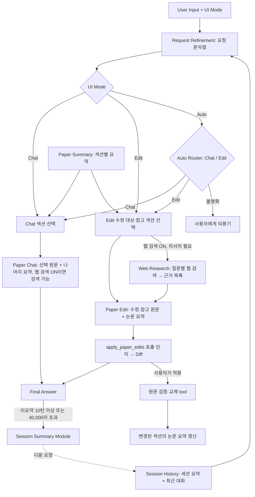
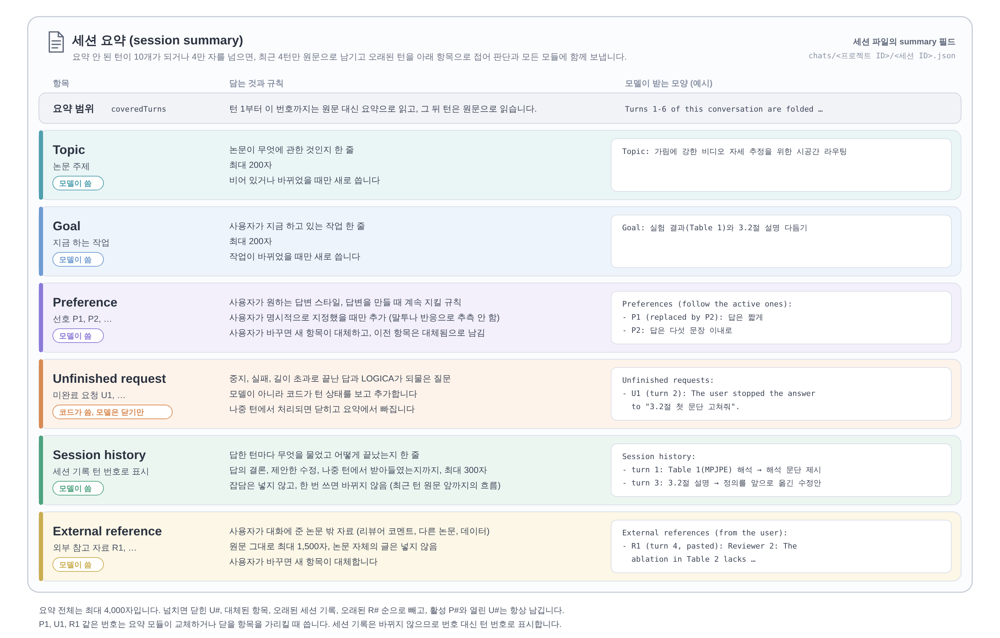

# 작동 구조

LOGICA의 AI 에이전트가 요청을 처리하는 단계, 대화와 논문을 기억하는 방식, 코드 구조입니다. 앱 사용법은 [README](../README.md)를 보세요.

## AI context 구성

채팅은 논문에 대한 첫 질문에서 먼저 논문을 섹션별로 요약해 두고, 질문에 필요한 섹션만 원문으로, 나머지 섹션은 그 요약으로 보냅니다.

채팅은 `UI Mode → Request Refinement → Routing → Section Selection → Execution` 순서로 처리합니다. 입력창 왼쪽의 **Chat**은 논문 질의응답, **Edit**은 원문 수정안 생성, **Auto**는 요청에 따른 Chat/Edit 자동 선택입니다. 전송한 모드는 해당 턴에 고정되며 대화 파일에 함께 저장됩니다.



- 채팅의 단계별 책임은 다음과 같습니다.
  1. **Request Refinement**: 모든 모드에서 세션 요약, 최근 대화, 사용자 입력으로 문맥과 지시 대상을 복원합니다. 출력은 정제된 요청 문자열 하나입니다. 의도 분류나 섹션 선택을 수행하지 않으며, 질문/명령, 부정, 조건, 요청 범위를 보존합니다.
  2. **Routing**: Chat/Edit은 코드가 경로를 고정합니다. Auto만 `route_chat`, `route_edit`, `clarify_request` 도구를 가진 모델을 호출합니다. 이 모델에는 원래 입력, 정제된 요청, 대화 정보와 논문 지도를 보내며 원문 선택은 맡기지 않습니다. 의도가 불명확하거나 tool 호출이 유효하지 않으면 확인 질문을 반환합니다.
  3. **Section Selection**: 정해진 실행 모드에서 논문 지도(섹션별 key, title, label, 요약), 원래 입력, 정제된 요청, 대화를 읽습니다. Chat은 `select_chat_sections`의 `sections`로 원문이 필요한 섹션을, Edit은 `select_edit_sections`의 `edit_sections`와 `reference_sections`로 수정 대상과 참고 대상을 구분합니다. 섹션 인자는 논문 지도의 key와 `all`만 허용하는 enum이라 strict 도구 호출에서 다른 값이 나오지 않으며, 대소문자만 다른 key는 논문의 key로 읽습니다. 코드의 `resolveScope()`와 `paperRequest()`가 원문·요약을 구성합니다. Edit에서 선택된 대상과 참고 섹션은 모두 원문을 확보해야 실행합니다.
  4. **Execution**: Paper Chat은 질의응답 전용이며 수정 tool을 제공하지 않습니다. 더 필요한 원문이 있으면 `[[need_sections: 4.3]]`으로 한 번 추가 요청할 수 있습니다. Paper Edit은 원래 입력, 정제된 요청, 세션 기록, 전체 섹션 요약, 수정·참고 섹션 원문, 전용 수정 지침으로 변경안을 만들고 `apply_paper_edits`를 호출합니다. 인자는 변경 설명 `summary`와 `edits: [{ path, original, revised }]`입니다. 읽기 전용 참고 섹션이나 요약만 보고 만든 수정안은 실행 대상으로 받지 않습니다.
  5. **적용**: tool 인자는 먼저 diff로 표시합니다. 사용자가 개별 적용/모두 적용을 누르면 현재 프로젝트·세션과 저장된 제안을 확인하고, 현재 파일에서 원문이 정확하고 유일하게 일치하는지, 수정 구간이 겹치지 않는지 검증합니다. 모두 적용은 전체 검증 후 파일별 아래쪽 구간부터 교체합니다. 검증에 실패하면 아무것도 적용하지 않고, 단독으로도 적용할 수 없는 수정안만 실패로 표시하며 나머지는 다시 적용할 수 있게 남깁니다. 편집기 버퍼에 반영하므로 기존 저장·되돌리기 흐름을 따릅니다. 실제 적용 뒤 변경 섹션 해시를 다시 확인해 논문 요약을 갱신합니다.
- 제목·저자는 `metadata` 항목으로 분리합니다. 코드가 `\title`·`\author` 선언에서 정보와 해시를 추출해 논문 지도와 YAML에 반영하며, 별도 LLM 요약을 하지 않습니다. 제목·저자 수정에는 이 항목의 선언 원문을 전달하고, `all` 선택에는 preamble을 포함한 전체 파일을 허용합니다.
- 파일을 읽을 때 CRLF/CR 줄바꿈을 LF로 통일해, 열지 않은 파일의 수정안도 편집기에 연 뒤 정확 일치 검사를 통과하도록 합니다. 이전 세션의 저장된 수정안도 같은 형식으로 불러오며 일반 공백·문장·수치의 일치 검사는 유지합니다.
- Chat/Edit의 기본 LLM 호출은 정제·선택·실행 3회이며 Auto는 의도 판단 1회가 추가됩니다. 최초 논문 요약, Chat의 추가 원문 요청, Edit의 웹 리서치, 백그라운드 요약과 provider fallback은 별도입니다. 정제·섹션 선택은 `gpt-6.1-sol` low, Chat/Edit은 Settings에서 고른 모델 medium, Auto Router는 `claude-sonnet-5-5` xhigh입니다. 모델과 대체 provider는 `src/ai/models/modelConfig.ts`에서 관리합니다.
- 논문 요약은 첫 요청에서 준비하고, 그 이후에는 섹션 해시가 바뀌거나 요약이 누락된 부분만 갱신합니다. 원고 입력 한도는 150,000자입니다. 편집기의 열린 탭이나 커서 위치로 대상을 추측하지 않으므로 요청에 섹션이나 문장을 지정합니다.
- 모든 단계는 세션 요약(L1)과 최근 대화 원문(L2)을 사용합니다. 최소 최근 4턴과 미요약 턴을 포함하며 메시지당 Auto Router는 최대 10,000자, 다른 모듈은 4,000자로 제한합니다. 긴 메시지는 앞 70%와 뒤 30%를 남깁니다. 현재 요청(L3)은 자르지 않습니다.
- Session Summary Module은 미요약 대화가 10턴 이상이거나 모듈이 읽는 길이 기준 40,000자를 넘으면 최근 4턴을 남기고 한 번에 최대 6턴씩 접습니다. 중지·실패·길이 초과도 미완료 상태를 붙여 턴으로 남깁니다. 수정안은 원문·수정문과 적용/대기/거절 상태를 대화 기록에 포함해 다음 요청이 실제 적용 여부를 알 수 있게 합니다.
- 디버거에는 UI 모드, 원래 입력과 정제 요청, Auto 판단 근거, 선택된 수정·참고 섹션, 실제 모델 프롬프트와 tool 인자, 원문 검증·적용 결과가 기록됩니다. Paper Summary Module은 고정된 위치에서 YAML 생성·재사용·갱신 연결을 보여주고, Session Summary Module은 별도 조건에 따라 실행됩니다.

문단은 빈 줄로 나누며, `\section`, `\begin`/`\end`, `\label`, 주석 줄 같은 구조 줄과 `\title`, `\author`, `\date` 같은 앞부분 명령(여러 줄에 걸치면 닫는 중괄호까지), 그리고 `\begin{document}` 앞의 preamble 전체는 문단에 넣지 않습니다. 그래서 "이 문단 고쳐줘"가 section 제목이나 논문 제목을 바꾸지 않습니다.

## 웹 검색

채팅 입력창의 **Web** 토글을 켜면 provider의 내장 웹 검색 도구를 씁니다(OpenAI Responses API의 `web_search`, Anthropic Messages API의 `web_search`). 검색은 provider 쪽에서 실행되고, LOGICA는 검색어와 출처만 받아 표시합니다. 구현은 `src/chat/orchestrator.ts`와 `src/ai/providers/webSearch.ts`에 있습니다.

- **Chat**: Paper Chat에 웹 검색 도구를 함께 줍니다. 모델이 논문만으로 부족하다고 판단할 때 검색하며, 검색 중에는 검색어를, 답변 아래에는 출처를 표시합니다.
- **Edit**: Section Selection이 수정 대상과 함께 `research`(리서치 필요 여부와 검색할 질문 최대 3개)를 정합니다. 필요하다고 판단하면 Paper Edit 전에 **Web Research** 단계가 질문과 고칠 원문(최대 40,000자)을 읽고 웹을 검색해, id가 붙은 근거 목록과 찾지 못한 정보(`research_gaps`)를 만듭니다. Paper Edit은 이 근거를 받아 `apply_paper_edits`의 각 수정에 기댄 근거 id(`evidence`)를 적고, 찾지 못한 정보는 기억으로 채우지 않습니다. 화면에는 수정안마다 근거와 출처, "웹에서 찾지 못한 정보"가 표시됩니다.
- Research 호출 한 번의 검색은 최대 5회입니다. Claude는 항상, OpenAI는 API key로 연결했을 때 이 제한을 요청에 넣습니다.
- Auto는 의도 판단으로 정해진 경로(Chat/Edit)에 따라 위와 같이 동작합니다. 웹 검색이 꺼져 있으면 Research 단계는 실행되지 않고, 수정 tool에도 `evidence` 인자가 없습니다.

## 모델과 fallback

Chat 답변과 Edit 수정안은 Settings의 기본 provider와 그 provider에 고른 모델로 호출하고, 실패하면 다른 provider에 고른 모델로 다시 호출합니다(`chosenModels`). 나머지 호출의 모델은 `src/ai/models/modelConfig.ts`의 `CHAT_MODELS`에 고정되어 있습니다. LLM Gateway(`src/ai/gateway.ts`)는 기본 모델 호출이 실패하면, 아직 답변이 화면에 나오지 않았고 대체 provider가 연결되어 있을 때 대체 모델로 다시 호출합니다.

| 호출 | 기본 모델 | 대체 모델 |
| --- | --- | --- |
| 요청 정리, 섹션 선택, 세션 요약, 섹션 요약 | `gpt-6.1-sol` (low) | `claude-sonnet-5-5` |
| 답변, 수정안 | Settings에서 고른 모델 (medium) | 다른 provider에 고른 모델 (medium) |
| 웹 리서치 | `gpt-6.1-sol` (medium) | `claude-sonnet-5-5` |
| Auto 의도 판단 | `claude-sonnet-5-5` (xhigh) | `gpt-6.1-sol` (low) |

모델 ID는 `src/ai/models/modelConfig.ts` 한 곳에만 기본값으로 둡니다. provider를 연결하면 Settings에서 **Refresh list**로 계정에서 실제로 쓸 수 있는 모델 목록을 provider API에서 가져오고, 목록에 없는 모델 ID도 직접 추가할 수 있습니다. 선택한 모델은 provider별로 저장됩니다.

## 저장 파일

| 데이터 | 위치 (Windows 기준) |
| --- | --- |
| 논문 원고와 컴파일 결과 | 논문 폴더 (기본: `문서\LOGICA\My Paper N`) |
| AI 채팅 기록 | `%LOCALAPPDATA%\app.logica.desktop\chats\<프로젝트 ID>\<세션 ID>.json` (프로젝트 ID는 폴더 경로의 SHA-256 해시, 각 폴더의 `project.json`에 원래 경로 기록) |
| 논문 요약 (섹션별 요약, YAML) | `%LOCALAPPDATA%\app.logica.desktop\papers\<프로젝트 ID>\paper-summary.yaml` (프로젝트 ID는 채팅 기록과 같음) |
| 설정, 최근 작업, 창 배치 | `%APPDATA%\app.logica.desktop\state.json` |

API key와 ChatGPT 로그인 토큰은 파일이 아니라 Windows 자격 증명 관리자에 있습니다.

채팅 세션 파일 형식은 `{ version, createdAt, updatedAt, messages, summary }`이며, `summary`의 구조는 아래 [세션 요약 구조](#세션-요약-구조)에 있습니다. 채팅창의 기록 버튼에서 이전 대화를 불러오거나 삭제하고, 새 대화 버튼으로 새 세션을 시작합니다. 논문 요약(섹션별 요약)은 세션과 따로 프로젝트마다 하나이며, 형식은 아래 [논문 요약 문서](#논문-요약-문서)에 있습니다. AI 호출 때 외부로 보내는 내용은 [인증과 보안](security.md#외부로-전송되는-데이터)에 있습니다.

## 세션 요약 구조



세션 요약은 대화가 길어질 때 오래된 턴을 원문 대신 줄여 보내는 대화 메모리입니다(원본 그림: [`images/session-summary.svg`](images/session-summary.svg)). 세션 파일(`chats/<프로젝트 ID>/<세션 ID>.json`)의 `summary` 필드에 저장되고, 판단과 모든 모듈이 최근 턴 원문과 함께 읽습니다. 구조는 다음과 같습니다.

- **요약 범위** (`coveredTurns`): 턴 1부터 이 번호까지는 원문 대신 요약으로 읽고, 그 뒤 턴은 원문으로 읽습니다.
- **Topic** (논문 주제): 논문이 무엇에 관한 것인지 한 줄(최대 1,000자)입니다. 비어 있거나 바뀌었을 때만 새로 씁니다.
- **Goal** (지금 하는 작업): 사용자가 지금 하고 있는 작업 한 줄(최대 1,000자)입니다. 작업이 바뀌었을 때만 새로 씁니다.
- **Preference** (선호, P#): 사용자가 원하는 답변 스타일이나 답변을 만들 때 계속 지켜야 하는 규칙입니다. 사용자가 명시적으로 지정했을 때만 추가하고, 말투나 반응으로 추측하지 않습니다. 사용자가 바꾸면 새 항목이 대체하고, 이전 항목은 대체됨으로 표시해 남깁니다.
- **Session history** (세션 기록): 답한 턴마다 무엇을 물었고(섹션, 그림, 표, 수식) 어떻게 끝났는지(답의 결론이나 제안한 수정, 나중 턴에서 받아들였는지)를 한 줄(최대 300자)로 남깁니다. 잡담은 넣지 않고, 한 번 쓰면 바뀌지 않습니다. 최근 턴 원문 바로 앞까지의 대화 흐름이 됩니다.
- **External reference** (외부 참고 자료, R#): 사용자가 대화에 준 논문 밖 자료(리뷰어 코멘트, 다른 논문의 글, 데이터)를 원문 그대로 최대 1,500자까지 담습니다. 논문 자체의 글은 넣지 않습니다.

P1, R1 같은 번호는 요약 모듈이 교체할 항목을 가리킬 때 씁니다. 세션 기록은 바뀌지 않으므로 번호 대신 턴 번호로 표시합니다. 요약 전체는 최대 4,000자이며, 넘치면 대체된 항목, 오래된 세션 기록, 오래된 R# 순으로 빼고 활성 P#는 항상 남깁니다. 중단되거나 실패한 요청은 요약에 남기지 않습니다. 필요하면 사용자가 다시 요청합니다. 이전 형식으로 저장된 세션은 Goal을 그대로 읽고, 다룬 내용(T#) 항목은 세션 기록으로 옮기며, 답하지 못한 요청(U#) 항목은 버립니다.

## 논문 요약 문서

논문에 대한 첫 질문에서 Paper Summary Module(`src/chat/paper/`)이 판단보다 먼저 논문을 섹션별로 요약해 YAML 문서로 저장합니다. 판단은 이 요약을 논문 지도로 받아 원문으로 읽을 섹션을 고르고, 정제와 답변은 고르지 않은 섹션을 이 요약으로 읽습니다.

- 순서: 논문의 읽는 순서대로 abstract(제목 블록과 초록), introduction, 이후 섹션이 이어지고, 하위 절은 `subsections` 아래에 들어갑니다.
- 요약: 섹션마다 논문의 언어로 3~4줄(한 줄에 한 문장)입니다. 자기 본문이 없는 섹션(제목과 label만 있고 내용은 하위 절에 있는 섹션 포함)은 "아직 내용 없음", 본문이 아주 짧은 섹션은 본문을 그대로 씁니다.
- 갱신: 처음 한 번 만든 뒤에는, 본문을 고친 섹션만 그 턴에는 원문으로 읽고 턴이 끝난 뒤 다시 요약합니다. `hash`(섹션 본문의 해시)로 바뀐 섹션을 찾습니다.
- 요약을 만들지 못하면 그 질문은 원고 전체로 답하고, 턴이 끝난 뒤 다시 시도합니다.

```yaml
version: 1
title: Adaptive Spatiotemporal Routing for Occlusion-Robust Video Pose Estimation
updated: 2026-10-21T07:00:00.000Z
sections:
  - key: abstract
    title: Abstract
    hash: 16cef576833269
    summary: |-
      Video pose estimation degrades sharply when body parts are occluded.
      STRoute estimates per-joint uncertainty and routes each joint through spatial or temporal reasoning.
      On two benchmarks it reduces the error on occluded joints at low inference cost.
  - key: "1"
    title: Introduction
    hash: 02e102b54557ae
    summary: 아직 내용 없음
    subsections:
      - key: "1.1"
        title: Motivation
        hash: 00c86d4da64c3e
        summary: |-
          Pose estimation from video underlies action recognition, sports analytics and rehabilitation.
          Previous methods ignore uncertainty and fail under occlusion, which is common in real videos.
          This motivates handling occluded joints explicitly.
```

## 프롬프트와 결과 검사

prompt는 provider와 무관하게 `src/ai/prompts/`에서 만들고(LaTeX 규칙: 명령어, citation key, `\label`, 수식, 기호, custom macro, `%` 주석 보존), 각 adapter는 이를 자기 메시지 형식으로만 바꿉니다.

AI 결과는 적용 전에 `src/latex/validation.ts`로 검사합니다: 중괄호, `\begin`/`\end`, `$` 수식 구분자 균형, 사라지거나 바뀐 `\label`, bib에 없는 새 citation key는 오류로, 바뀐 수식, 삭제된 citation/ref/주석/명령어는 경고로 diff 아래에 표시합니다. 오류가 있으면 버튼이 **Accept anyway**로 바뀝니다.

## 코드 구조

```
src/
├── editor/            CodeMirror 설정, 다중 파일 세션, 자동완성, 수정안 대상 하이라이트
├── outline/           논문 outline 패널
├── project/           프로젝트 열기/저장/컴파일/탐색 흐름, 파일 탐색기
├── latex/
│   ├── parser/        문서 모델(PaperDocument): \input/\include, section, label, ref, title, abstract
│   ├── compiler/      컴파일 호출, LaTeX log 오류 추출
│   ├── bibtex/        BibTeX 파서
│   └── validation.ts  AI 결과 LaTeX 검사
├── ai/
│   ├── types/         AIProvider, AIRequest, AIResponse, ModelConfig
│   ├── providers/     openai/, anthropic/ adapter와 registry
│   ├── prompts/       system, 채팅의 judge, refine, answer, summary, sectionSummary (paper.ts가 공통 앞부분)
│   ├── streaming/     SSE parser, backend transport
│   ├── credentials/   credential 상태 조회/저장/삭제
│   ├── models/        모델 설정 (고정 호출의 CHAT_MODELS, 설정 모델을 쓰는 chosenModels)
│   ├── tools/         모델이 부르는 툴 정의 (판단의 세 갈래, update_summary, write_section_summaries)
│   ├── gateway.ts     LLM Gateway: 채팅 호출의 모델 선택, Claude fallback, 호출 추적
│   └── service.ts     UI가 쓰는 유일한 AI 진입점
├── chat/              AI 채팅 패널, 대화 상태(chatStore), Paper Orchestra(orchestrator.ts), 섹션 단위와 논문 요약(paper/), 세션 요약과 턴 기록(session/)
├── pdf/               pdf.js 미리보기
├── settings/          설정 저장소, 연결 상태, 설정 창
├── storage/           작업 상태 저장/복원
└── dev/               브라우저 미리보기용 가짜 backend (배포 빌드 제외)

src-tauri/src/
├── project.rs         프로젝트 폴더 안 파일 읽기/쓰기(외부 수정 충돌 감지)
├── compile.rs         latexmk/pdflatex/xelatex 실행, 타임아웃
├── credentials.rs     OS credential store
├── ai.rs              credential을 붙여 provider endpoint로 보내는 streaming proxy, 취소
├── chats.rs           채팅 기록 저장
├── papers.rs          논문 요약(YAML) 저장
└── app_state.rs       비밀이 아닌 앱 상태 저장
```

의존 방향:

```
Chat UI → Request Refinement → Paper Orchestra → Section Selection → Chat / Edit Module
                                                               ↓
                                          LLM Gateway (모델 선택, provider fallback)
                                                               ↓
                                          AI Service (src/ai/service.ts)
                                                               ↓
                                          AIProvider interface
                                                               ↓
                                          ├── OpenAI adapter     ─┐
                                          └── Anthropic adapter  ─┴→ transport → Rust ai.rs (key 첨부) → provider API
```

UI 컴포넌트는 vendor API를 직접 호출하지 않습니다.
